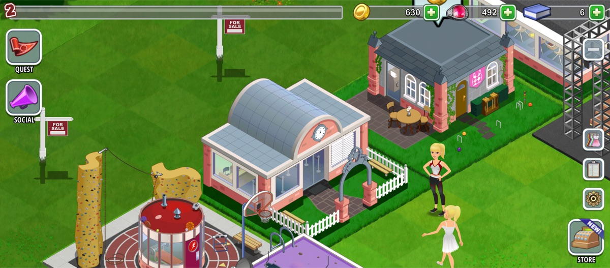
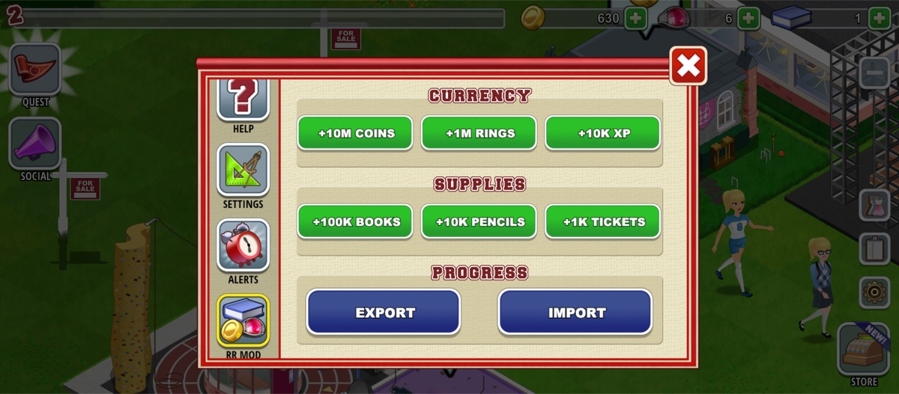
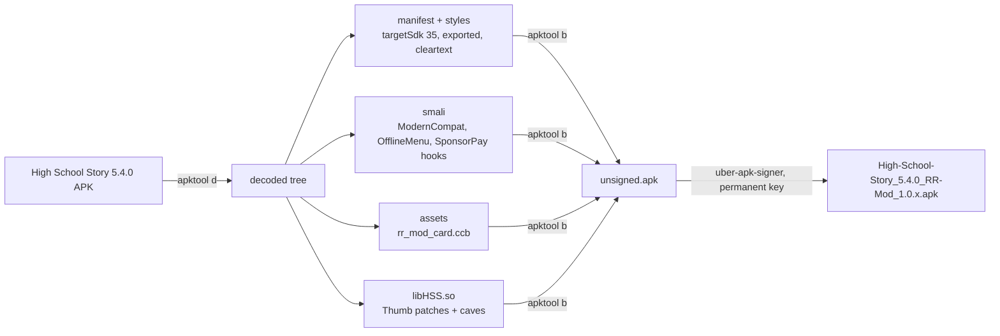

<div align="center">

# 🏫 High School Story · RR Mod

**High School Story 5.4.0, rebuilt to run on the phone alone — current Android, an offline store, unlocked store cards, and a native RR MOD settings tab.**

[](https://github.com/RobyRew/high-school-story/releases/latest)


[](LICENSE)



</div>

Pixelberry's servers for High School Story are gone. The last Android client, 5.4.0, still targets Android 8, its store talks to Google Play and a Pixelberry account server, and several store paths end on *Network error* screens. This repository rewrites that APK so the game and its store run on the phone.

> [!NOTE]
> High School Story, its art, scripts and native library are © Pixelberry Studios. This repository holds only the patcher; you supply the 5.4.0 APK. The patcher code is MIT.

---

## ✨ What you get

<table>
<tr>
<td width="50%" valign="top">

### 📱 Runs on today's phones
- `targetSdkVersion` **35** — no "built for an older version of Android" block
- `exported` flags, `PendingIntent` immutability and receiver export flags for Android 12+
- 32-bit libraries also packaged as `armeabi-v7a`
- Cleartext HTTP, legacy storage and `org.apache.http.legacy` kept for the old SDKs

</td>
<td width="50%" valign="top">

### 🔌 No servers, no account
- 5.4.0 falls back to the phone clock when no server answers — no server-time patch
- No Google Play billing, no Pixelberry account, no signal needed to buy
- Currency and clothing tabs skip their "Network error" screens
- Leftover Java calls after a buy (sound, analytics, LeanPlum, reward scene) are skipped

</td>
</tr>
<tr>
<td valign="top">

### 🛍️ Store that pays out
- Ring, coin, book and pencil packs, bundles, buildings, outfits and classmates buy locally and grant **what the game's config says**
- *Unlocks with Quest …* cards, level- and building-gated classmates, the Decor tab, makeovers and date-locked clothes are buyable
- Quests keep the game's own rules — nothing is marked complete for you

</td>
<td valign="top">

### ⚙️ RR MOD settings tab
- A fourth tab in the game's own Settings dialog, next to **Help · Settings · Alerts**
- Built in the game's `.ccb` format from its Settings card: same panels, fonts and buttons
- Grants go straight into the wallet, so the HUD counters move
- **Export / import** the real save (`files/`, `shared_prefs/`, `databases/`)

</td>
</tr>
</table>

### 🆕 The RR MOD tab

| Section | Buttons |
| --- | --- |
| **Currency** | `+10M COINS` · `+1M RINGS` · `+10K XP` |
| **Supplies** | `+100K BOOKS` · `+10K PENCILS` · `+1K TICKETS` |
| **Progress** | `EXPORT` · `IMPORT` |

Every wallet the game has can be topped up: coins, rings (the premium currency), books, pencils, tickets and XP. Tap a button as often as you like.

<div align="center">

</div>

<div align="center">

</div>

---

## 📥 Install

1. Download `High-School-Story_5.4.0_RR-Mod_1.0.x.apk` from [**Releases**](https://github.com/RobyRew/high-school-story/releases/latest) and copy it to the phone. Each release also carries `High-School-Story_5.4.0_original.apk`, Pixelberry's untouched client, and `SHA256SUMS.txt`.
2. Play Protect will say it doesn't know the developer — that's the mod's own signing key. Choose **Install anyway**.
3. Open the game, then **gear → RR MOD** for currency and save export/import.

Every RR-Mod release is signed with the same key, so a new release installs over the old one and keeps your save.

> [!IMPORTANT]
> **Coming from Pixelberry's Play Store build:** only Pixelberry holds that signing key, so Android won't update it in place, and uninstalling it deletes its save. Install the RR-Mod build once; from then on every release updates in place.

<details>
<summary><b>📵 Phones it can't run on</b></summary>

The client ships only 32-bit ARM code (`libHSS.so`). Phones that dropped 32-bit support — Samsung from the Galaxy S24 and A55, recent Pixels — report the app as incompatible, and no manifest change fixes that. Any phone or emulator that still runs 32-bit ARM can.

</details>

---

## 🛠️ Build it yourself



**Needs:** Python 3.9+, a JDK 17+ (`java` on `PATH`, `JAVA_HOME`, Homebrew's `openjdk@21`, or `--java`). Apktool 3.0.3 and uber-apk-signer 1.3.0 are in `tools/` (licenses in `tools/THIRD_PARTY.txt`).

```bash
python3 patcher/patch_apk.py --apk "High+School+Story_5.4.0_APKPure.apk"
```

The result is `dist/High-School-Story_5.4.0_RR-Mod_1.0.x.apk`. Releases stay on `1.0.x`; `VERSION_PATCH` in `patcher/patch_apk.py` is the only number to bump.

> [!IMPORTANT]
> **One key signs everything.** Builds are signed with `build/offline.keystore` (alias `hss`), or the file in `SIGNING_KEYSTORE` with the password in `SIGNING_PASSWORD`. A gitignored copy lives in `signing/offline.keystore` and is restored when `build/` is wiped. A local run creates the key only when neither exists; on CI a missing key stops the build.

| Option | Default |
| --- | --- |
| `--apk` | *(required)* the 5.4.0 APK, package `com.pixelberrystudios.hssandroid` |
| `--out` | `dist/High-School-Story_5.4.0_RR-Mod_1.0.x.apk` |
| `--java` | `JAVA_HOME/bin/java`, Homebrew `openjdk@21`, then `java` on `PATH` |
| `--work` | `build/decoded` |

Every native patch checks the original bytes first, so any version other than 5.4.0 stops with an error instead of writing a broken library.

### GitHub Actions

| Workflow | Runs on | Does |
| --- | --- | --- |
| **Check patcher** | every push and PR | compiles the Python |
| **Build and release** | manual run, or a pushed `1.0.x` tag | downloads the original from the `source-apk` release, patches it, signs it with the permanent key, and publishes release `1.0.x` with the RR-Mod APK, the original APK and `SHA256SUMS.txt` |

To ship a new version: bump `VERSION_PATCH`, push, then run **Build and release** (or push the matching tag, e.g. `git tag 1.0.4 && git push origin 1.0.4`).

The workflow needs the original APK attached to a release tagged `source-apk`, and two repo secrets, set once:

```bash
base64 -i signing/offline.keystore | gh secret set SIGNING_KEYSTORE_B64
gh secret set SIGNING_PASSWORD --body android
```

---

## 🗂️ Repository map

```text
patcher/
├── patch_apk.py        decode → patch manifest, styles, smali, assets, lib → build → sign (versions, names, key)
├── hss_native.py       libHSS.so byte patches: store, gates, locks, RR MOD tab caves, grant dispatcher
├── rr_card.py          builds rr_mod_card.ccb from the game's Settings card
├── ModernCompat.smali  PendingIntent / registerReceiver / notification shims
└── OfflineMenu*.smali  RR MOD actions, export/import
docs/REVERSE.md         every address, what it was and why it changed
tools/                  apktool, uber-apk-signer
```

How each patch site was found — by symbol name, mapped from the Hollywood U patcher — is in [docs/REVERSE.md](docs/REVERSE.md).

---

## 🐞 Support

Open an [issue](https://github.com/RobyRew/high-school-story/issues) with:

- phone model and Android version
- fresh install or update
- a screenshot of the screen
- if you can, `adb logcat` from the moment it fails

<div align="center">
<sub>Patcher © RobyRew · MIT &nbsp;·&nbsp; High School Story © Pixelberry Studios, not licensed by this repository</sub>
</div>
